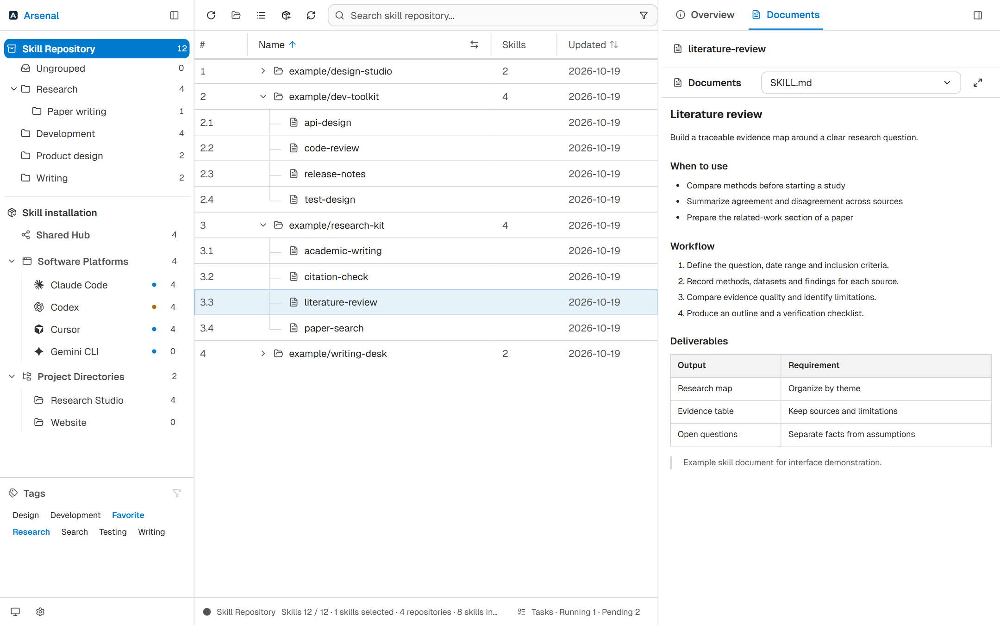
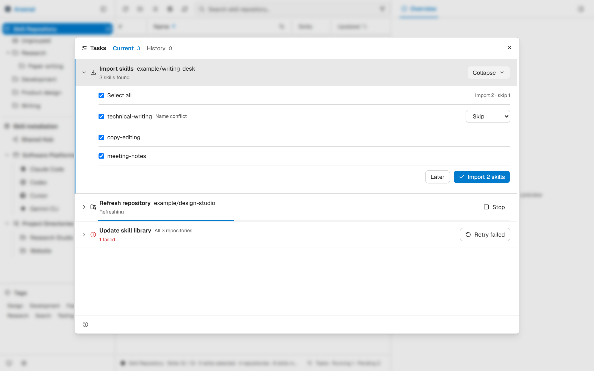
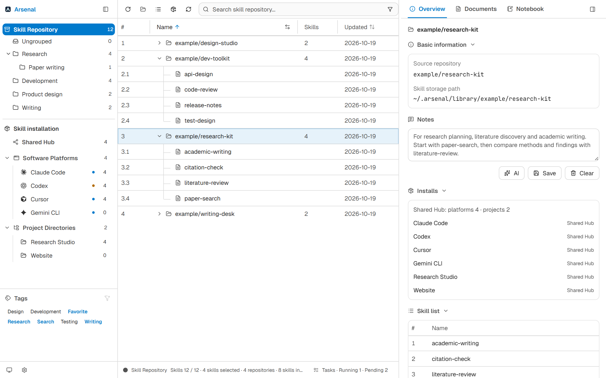
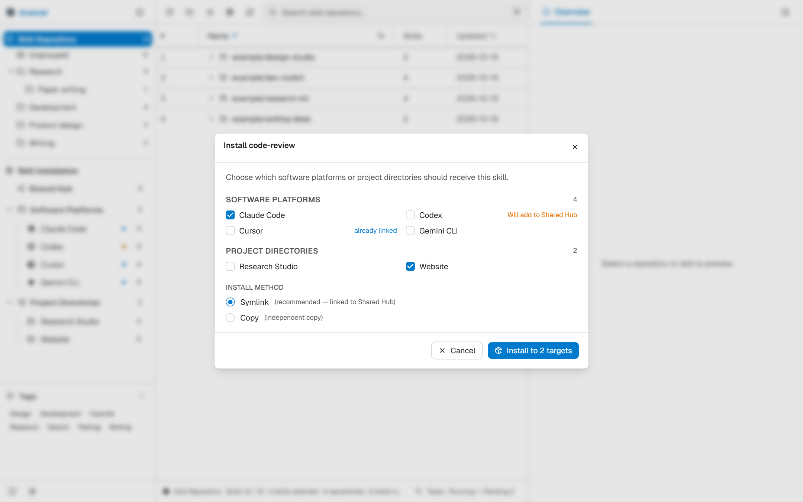
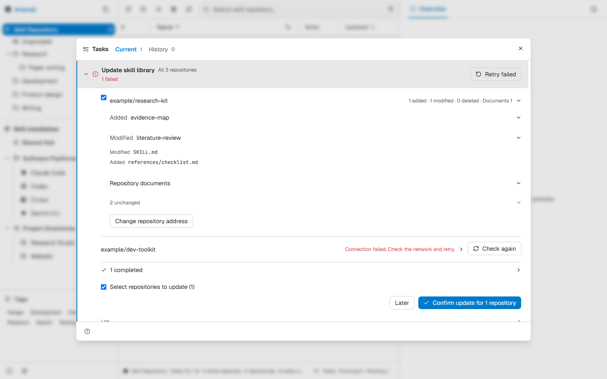
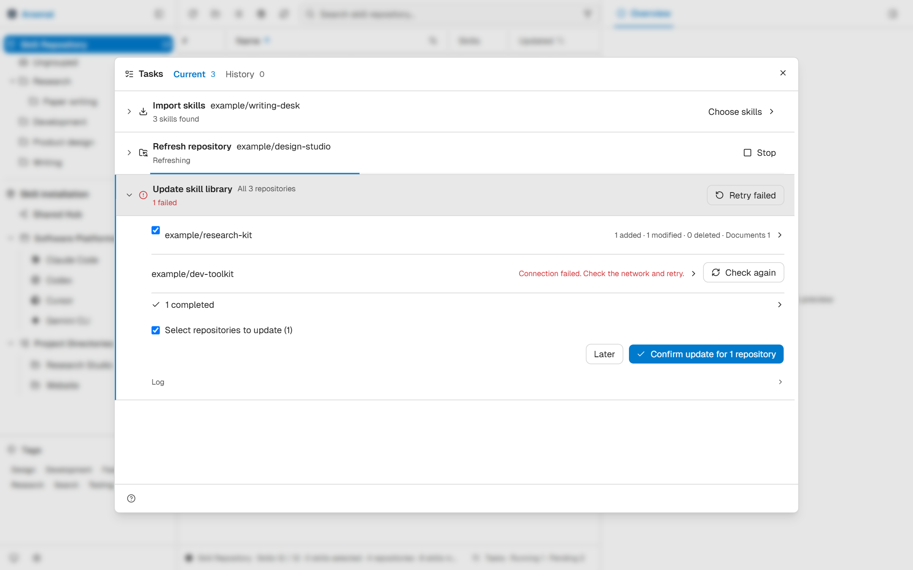

<p align="center"></p>
<h1 align="center">Arsenal</h1>
<p align="center"><strong>Your AI skills, organized and ready where you work.</strong></p>
<p align="center">AI tools and capabilities management · Collect · Organize · Install · Update · Annotate</p>
<p align="center">
  <a href="https://github.com/yufenglyu/Arsenal/releases"></a>
  <a href="LICENSE"></a>
</p>
<p align="center">
  <a href="https://github.com/yufenglyu/Arsenal/releases">Download</a> ·
  <a href="#at-a-glance">Features</a> ·
  <a href="#get-started">Get started</a> ·
  <a href="CHANGELOG.md">Changelog</a> ·
  <a href="README_CN.md">简体中文</a>
</p>

Arsenal brings **Skills** from GitHub, local folders and different AI tools into one desktop workspace. Organize your collection, install skills into tools such as Claude Code, Codex and Cursor—or individual projects—review upstream changes, and keep practical notes alongside the skills.



<p align="center"><sub>Current source UI with fictional demonstration data. Example skills are not bundled. Published releases may differ.</sub></p>

## At a glance

| Collect and organize | Install and maintain | Read and remember |
| --- | --- | --- |
| Import selected skills from GitHub or local folders | Shared Hub, software platforms and project directories | Read SKILL.md and repository documents side by side |
| Nested groups, drag and drop, multi-select and tags | See installation relationships; choose links or copies | Skill and repository remarks with AI assistance |
| Repository / flat views, search and sorting | Review repository changes, retry failures and resume checks | Connect Obsidian notes through stable links |

**One library, different working environments.** Keep literature tools in a research project, install review and testing skills into a development project, and place everyday capabilities in Shared Hub. See what is installed where without inspecting folders by hand.

## Choose what to import. Find it when you need it.

Add a GitHub URL or a local folder. If a repository contains multiple skills, select the ones you want. Resolve name conflicts by skipping, renaming or overwriting. When import preparation runs in the background, return to its task row to finish your choices.



Expand repositories by source and organize groups around your work. Drag repositories or skills into nested groups, filter by tags, or switch to a flat list to compare skills across sources. Search names, descriptions and remarks; adjust column widths and visible columns to fit your workflow.



## Collect once. Install by tool or project.

The library holds your original skill files. Choose destinations during installation and see existing links before making changes. Use symbolic links or create independent copies.

| Destination | Useful for |
| --- | --- |
| **Shared Hub** | A common set of skills for tools that support the shared directory |
| **Software platforms** | Separate skill selections for tools such as Claude Code and Cursor |
| **Project directories** | Capabilities scoped to a particular project |

Configure custom platforms and skill paths. Shared-directory discovery depends on each tool's support and configuration. Independent copies do not automatically change when the source files change.



## Review the changes before you update

**Refresh repository information** retrieves metadata, stars and documentation. **Update skill library** checks source content and lets you confirm synchronization. These are separate operations, available for a batch or a single repository.

Review additions, modifications, deletions and document changes by repository, then expand skills to inspect the affected files. Select repositories to update; retry failed checks individually.



> Source updates mirror the selected repositories. They overwrite local skill content and process upstream deletions. Keep personal knowledge in remarks or notes, and back up local edits you want to preserve.

## Batch work, with attention where it is needed

Tasks start with a batch summary. Skill selection, import conflicts and update reviews expand inside the corresponding row, keeping other tasks in context. Completed items can stay folded while errors and retry actions remain easy to find.



- **Resume checks:** progress is recorded per repository, so unfinished work can continue after stopping or restarting.
- **Keep working:** closing the task window leaves background work running.
- **Maintain caches automatically:** release unreferenced and completed snapshots while retaining reviews, retries and recovery data.
- **Reduce distractions:** AI remarks and explanations stay in their own views, outside the task window.

## Understand a skill—and remember how you use it

Read documents beside the library and record when a skill helps, what inputs it needs and where its limits are. AI can suggest remarks and tags for you to edit and confirm. Link longer practical records to Obsidian notes with stable identifiers.

See the [companion integration](integrations/) for Obsidian setup and requirements. AI features require a configured service and send relevant content to your selected provider.

## Get started

1. **Download:** choose an installer or portable archive from [Releases](https://github.com/yufenglyu/Arsenal/releases). Available operating systems, architectures and formats depend on the release assets.
2. **Import:** choose **Add skills** and enter a GitHub URL or select a local directory.
3. **Install:** select a skill and choose its platform or project destinations.
4. **Maintain:** organize groups, read documents and add remarks. Use **Update skills** to check upstream changes.

Default shortcuts: `Ctrl/Cmd + K` for global search, `Ctrl/Cmd + F` for page search, `F3` to switch repository / flat views, and `F5` to refresh the list. Shortcuts can be changed in Settings.

### Local data and backups

Skills and configuration are stored locally, with local and WebDAV backups available. Windows portable mode keeps `arsenal.exe` beside the `.arsenal` data directory. Exit and back up before upgrading; preserve your existing `.arsenal` instead of replacing it with packaged defaults.

Local browsing and organization do not require an AI service. GitHub imports, source checks, WebDAV and AI features connect to their respective services.

<details>
<summary><strong>Development and contributions</strong></summary>

React + TypeScript frontend, Tauri 2 + Rust desktop backend. Install Node.js, pnpm, Rust and the [Tauri system prerequisites](https://v2.tauri.app/start/prerequisites/).

```bash
pnpm install
pnpm tauri dev
```

```bash
pnpm typecheck
pnpm lint
pnpm test
cargo test --manifest-path src-tauri/Cargo.toml
pnpm tauri build
```

`pnpm dev` runs the frontend only; desktop capabilities require Tauri. See the [build, packaging and cleanup scripts](scripts/README.md), and the [screenshot reproduction guide](docs/screenshots/README.md).

Report issues through [GitHub Issues](https://github.com/yufenglyu/Arsenal/issues), including the OS, application version and reproduction steps. Remove personal data and credentials from screenshots and logs.

</details>

Licensed under [Apache-2.0](LICENSE). See [NOTICE](NOTICE) for third-party acknowledgments.
