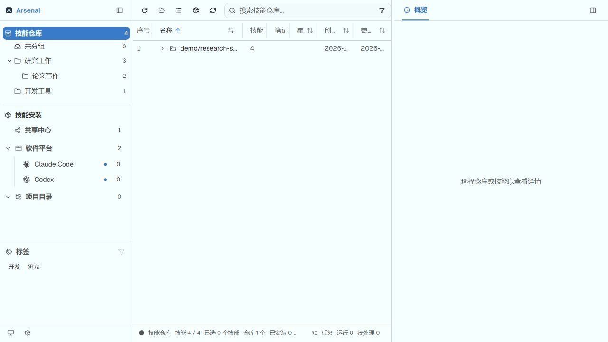
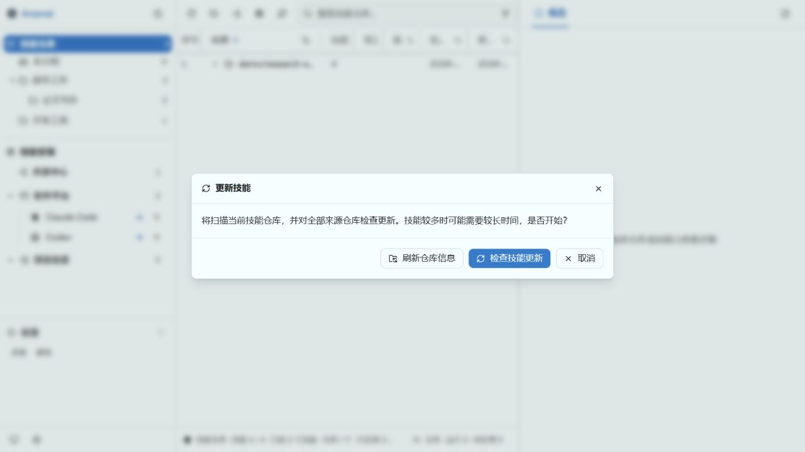

# Arsenal · 百器库

AI 工具与能力管理。当前版本专注于技能管理；模板、工作流与知识内容是后续扩展方向。

[English](README.md) · [下载](https://github.com/yufenglyu/Arsenal/releases) · [更新日志](CHANGELOG.zh.md)

截图来自 v1.3.0 的实际前端组件，使用虚构演示数据，不代表预装内容。

## 技能仓库与安装

从 GitHub 或本地文件夹导入技能。技能仓库是主存储；共享中心、软件平台和项目目录统一位于“技能安装”下。安装优先使用链接，必要时回退复制。

仓库下直接管理多级分组，支持拖入技能或仓库、拖拽排序、Shift 拖动转移、多选及展开折叠快捷键。分组内可以切换技能与仓库视图；“移除分组”只移除关联，“删除”需按弹窗确认其删除范围。新建分组在右键菜单中。

点击“技能仓库”和“技能安装”标题可折叠展开，仓库区域高度可拖动调整。左右栏收起后点击图标不会自动展开。表格支持列宽、显示列、排序与搜索，技能数列不参与排序。

## 更新与任务

- **刷新仓库信息**：刷新元信息、星标数和文档，不更新技能文件。
- **检查技能更新**：检查来源仓库，查看变更后再确认同步。
- 通过状态栏“任务”查看上次结果、运行进度和失败项；支持筛选、选择及重试。
- 检查按仓库保存进度。“暂停检查”在当前仓库完成后停止；退出后重新打开，在任务窗口点击“继续检查”，跳过已完成仓库。退出时尚未完成的仓库会重新检查。
- 清除记录与删除技能是不同操作；需要继续的任务应保留其记录。

## 笔记与整理

支持标签筛选、备注和 AI 辅助建议。Obsidian 笔记通过稳定标识关联；“新笔记子目录”相对于库目录，例如 `附件/SkillsHub`。备注与笔记使用不同图标。

## 便携与迁移

Windows 便携目录只需 `arsenal.exe` 和 `.arsenal`。升级前关闭旧程序，保留自己的 `.arsenal`，不要用包内默认配置覆盖现有数据。

首次启动会迁移旧 `.skillshub` 的配置路径和已安装链接，校验后移除兼容目录。两套独立数据目录同时存在时会停止迁移，避免覆盖。迁移备份保存在 `.arsenal/migrations`。协议、笔记属性和安装升级标识保持兼容。

## 开发与发布

`pnpm install` 安装依赖；`pnpm dev` 启动前端；`pnpm tauri dev` 启动桌面开发。

验证：`pnpm test`、`pnpm typecheck`、`cargo test --manifest-path src-tauri/Cargo.toml`。

打包：`pnpm package:release:windows`；macOS/Linux 对应脚本见 [打包说明](scripts/README.md)。以 Releases 实际附件为准，Windows 本地构建不代表其他平台已验证。

Apache-2.0，见 [LICENSE](LICENSE)。
