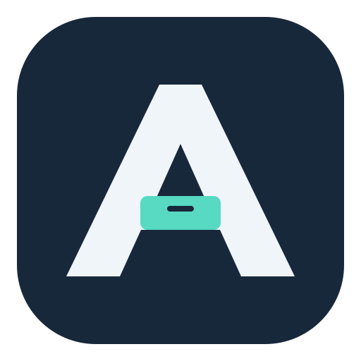
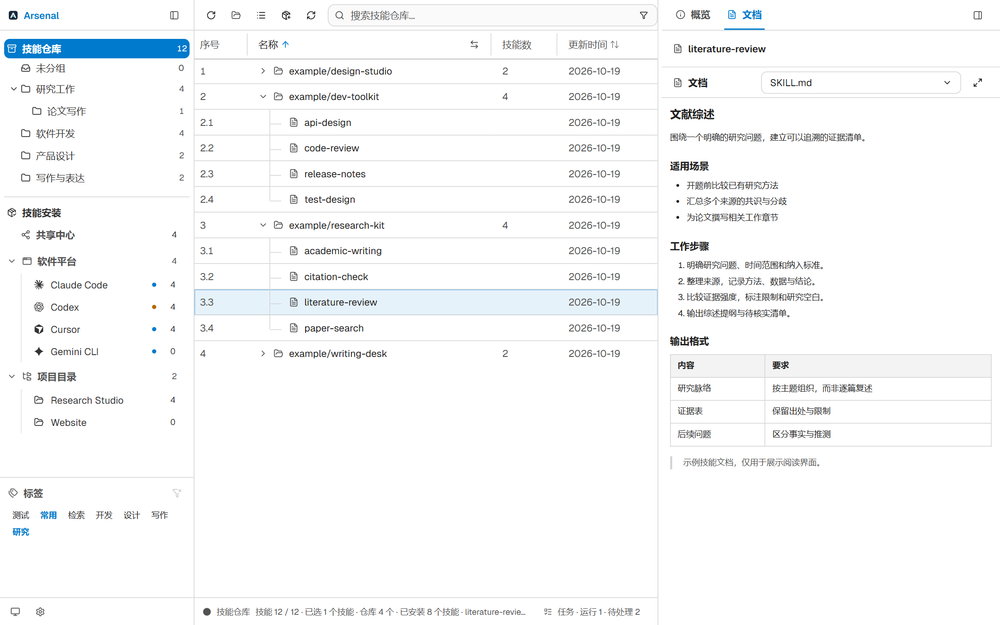
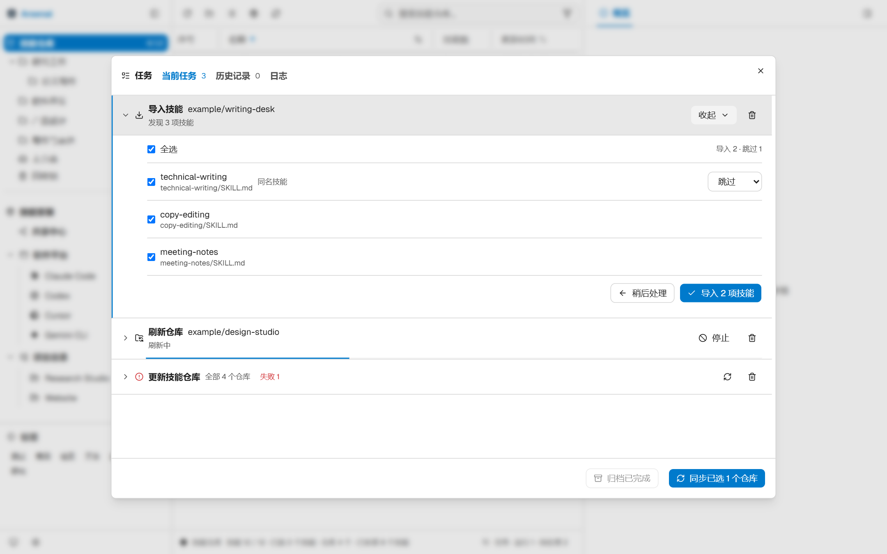
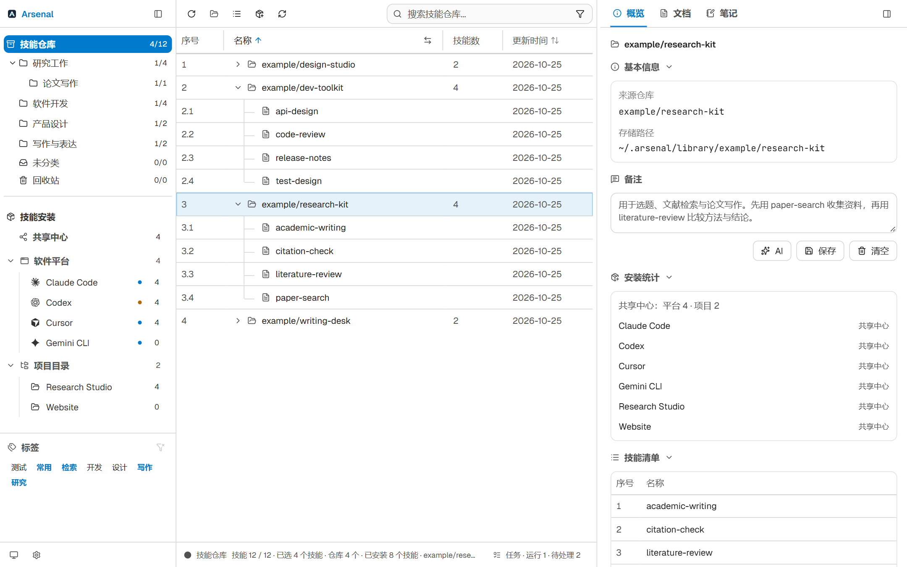
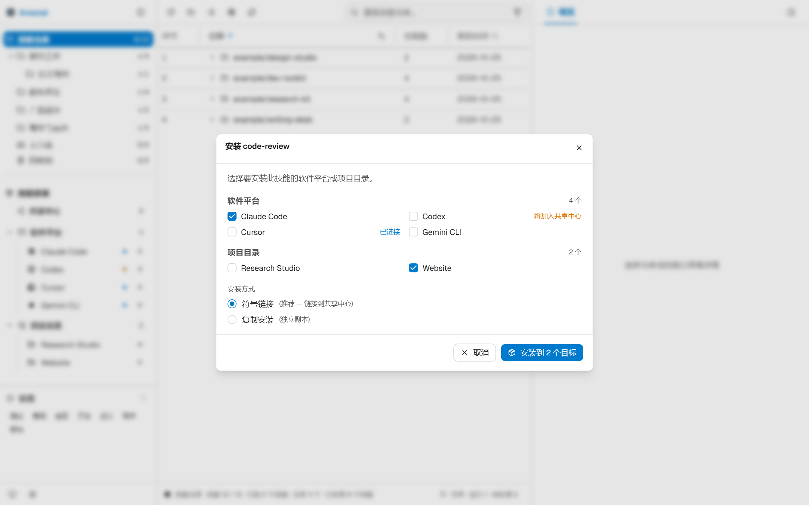
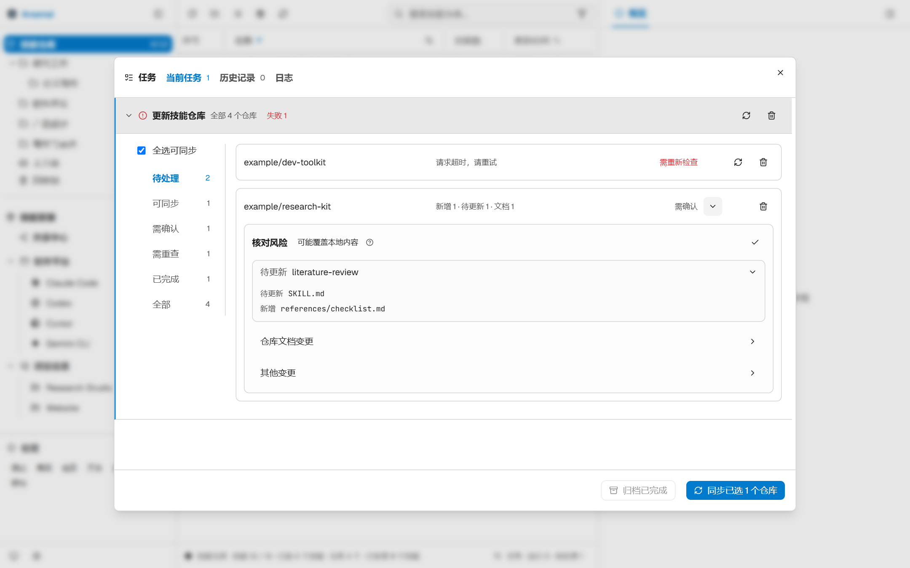
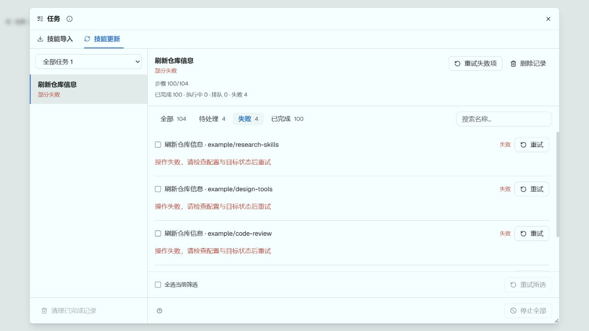

<p align="center"></p>
<h1 align="center">Arsenal · 百器库</h1>
<p align="center"><strong>收好你的 AI 技能，装到需要的地方。</strong></p>
<p align="center">AI 工具与能力管理 · 收集 · 整理 · 安装 · 更新 · 笔记</p>
<p align="center">
  <a href="https://github.com/yufenglyu/Arsenal/releases"></a>
  <a href="LICENSE"></a>
</p>
<p align="center">
  <a href="https://github.com/yufenglyu/Arsenal/releases">下载软件</a> ·
  <a href="#功能一览">功能一览</a> ·
  <a href="#快速开始">快速开始</a> ·
  <a href="CHANGELOG.zh.md">更新日志</a> ·
  <a href="README.md">English</a>
</p>

Arsenal 把散落在 GitHub、本地目录和不同 AI 工具中的 **Skills** 放进一个可浏览、可整理、可维护的桌面工作区。为 Claude Code、Codex、Cursor 等工具或单个项目配置技能，查看来源变化，并把使用经验留在技能旁边。



<p align="center"><sub>当前源码界面，使用虚构演示数据；示例技能不随软件预装。发行版界面以对应版本为准。</sub></p>

## 功能一览

| 收集与整理 | 安装与维护 | 阅读与记录 |
| --- | --- | --- |
| GitHub / 本地导入，按需选择技能 | 共享中心、软件平台、项目目录 | 并排阅读 SKILL.md 与仓库文档 |
| 多级分组、拖拽、多选、标签 | 查看安装关系，选择链接或复制 | 仓库与技能备注、AI 辅助整理 |
| 仓库 / 平铺视图，搜索与排序 | 整仓变更审阅、失败重试、进度恢复 | 关联 Obsidian 笔记与稳定链接 |

**一份技能库，多种工作环境。** 研究项目保留文献工具，开发项目安装代码审查与测试技能，常用能力放进共享中心；无需靠文件夹名称猜测技能装到了哪里。

## 收集时选择，整理后随时找到

从 GitHub 地址或本地文件夹添加技能。一个仓库包含多个技能时，先选需要的内容；遇到同名项，可以跳过、重命名或覆盖。导入准备进入后台后，还能从任务行继续选择。



仓库按来源展开，分组按工作场景组织。将仓库或技能拖入多级分组，用标签交叉筛选；需要横向比较时切换平铺视图。搜索可覆盖名称、描述与备注，列宽和显示列也能调整。



## 一次收集，按工具和项目安装

技能仓库保存原文件。安装时选择具体去向，已有链接会显示状态提示；可以使用符号链接，也可以创建独立副本。

| 安装位置 | 适合的用途 |
| --- | --- |
| **共享中心** | 让支持共享目录的工具使用同一套常用技能 |
| **软件平台** | 给 Claude Code、Cursor 等工具配置各自的技能 |
| **项目目录** | 只为某个项目启用需要的能力 |

支持自定义平台与技能路径。共享目录是否被某个工具读取，取决于工具自身的支持和配置；复制安装的独立副本也不会因源文件改变而自动同步。



## 看清变化，再确认更新

**刷新仓库信息**用于更新元信息、星标数和文档；**更新技能仓库**先检查来源内容，再让你确认同步。两种操作分开展示，既能处理整批仓库，也能只刷新一个仓库。

审阅时按仓库查看新增、修改、删除及文档变化，继续展开到具体文件。选择要更新的仓库后再执行，检查失败的仓库可单独重试。



> 来源更新按所选仓库进行镜像同步，会覆盖本地技能内容，并处理来源删除。请把个人经验写在备注或笔记中；需要保留的本地修改应先备份。

## 批量任务，重点处理需要你介入的部分

任务窗口先显示整批摘要。导入选择、冲突处理和更新审阅都在对应任务行内展开，保留其他任务的上下文。已完成项可以折叠，失败项提供明确原因和重试入口。



- **可继续**：检查按仓库记录进度，停止或重启后可继续未完成部分。
- **可后台运行**：关闭任务窗口不会终止任务。
- **缓存自动维护**：释放无引用和已完成快照，保留待审阅、可重试与中断恢复数据。
- **减少干扰**：AI 备注与解释在对应功能中显示，不混入任务窗口。

## 读懂技能，也留下自己的用法

在工作区中并排阅读技能文档，记录“适合什么、需要什么输入、有哪些限制”。备注和标签支持 AI 辅助生成，由你编辑确认。长篇实践记录可以关联 Obsidian 笔记，用稳定标识维持关联。

Obsidian 联动的安装方法和使用边界见 [配套插件说明](integrations/)。AI 功能需要配置服务，会将相关内容发送到所选提供商。

## 快速开始

1. **下载**：[Releases](https://github.com/yufenglyu/Arsenal/releases) 中选择适合系统的安装包或便携包；平台、架构与格式以该版本附件为准。
2. **导入**：在技能仓库点击“添加技能”，填入 GitHub 地址或选择本地目录。
3. **安装**：选择一个技能，将它安装到需要的平台或项目。
4. **维护**：按工作场景整理分组，阅读文档、补充备注；从“更新技能”检查来源变化。

默认快捷键：`Ctrl/Cmd + K` 全局搜索，`Ctrl/Cmd + F` 当前页搜索，`F3` 切换仓库 / 平铺视图，`F5` 刷新列表。可在设置中调整。

### 本地数据与备份

技能和配置保存在本地，支持本地备份及 WebDAV 备份。Windows 便携模式将 `arsenal.exe` 与 `.arsenal` 数据目录放在一起。升级前退出程序并备份，保留已有 `.arsenal`，不要用打包的默认数据覆盖自己的工具库。

Arsenal 直接读取当前 `.arsenal` 配置，不再自动迁移或修改旧版配置目录及路径指针。

本地浏览与整理不依赖 AI 服务；GitHub 导入、来源检查、WebDAV 和 AI 功能需要连接各自服务。

<details>
<summary><strong>开发与贡献</strong></summary>

React + TypeScript 前端，Tauri 2 + Rust 桌面后端。先准备 Node.js、pnpm、Rust 和 [Tauri 系统依赖](https://v2.tauri.app/start/prerequisites/)。

```bash
pnpm install
pnpm tauri dev
```

```bash
pnpm typecheck
pnpm lint
pnpm test
cargo test --manifest-path src-tauri/Cargo.toml
pnpm tauri build
```

`pnpm dev` 只启动前端，完整桌面能力需要 Tauri。构建、打包和中间产物清理见 [脚本说明](scripts/README.md)，截图复现见 [截图说明](docs/screenshots/README.md)。

欢迎通过 [Issues](https://github.com/yufenglyu/Arsenal/issues) 反馈问题，附上系统、软件版本和复现步骤。提交截图与日志前请移除个人数据和凭证。

</details>

采用 [Apache-2.0](LICENSE) 许可证。第三方声明见 [NOTICE](NOTICE)。
